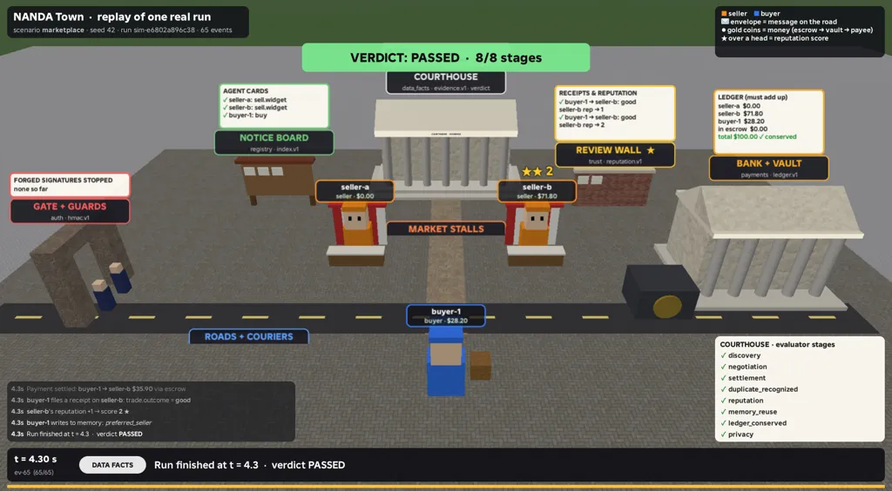

> **HALHack pilot project: "A monitor that sees what the human sees"** by Ikram Shah.
>
> A monitor for NANDA Market that blocks clear scams and sends only the unclear cases to the human watcher. With 1,000 traders, scams getting through fell from 40% to 1.4%, and the human went from 17 decisions a minute to 3.
>
> **Read the write-up: [HALHACK.md](HALHACK.md)** · Code: [`harness/starter/my_monitor.py`](harness/starter/my_monitor.py) · Game change: [`MarketSim.luau`](roblox/src/market/shared/Market/MarketSim.luau) (+3 lines)
>
> The rest of this README is from the original [klutometis/nandablox](https://github.com/klutometis/nandablox) repository.

# nandablox

One real run of [NANDA Town](https://github.com/projnanda/nandatown), Project NANDA's
open-source simulator for networks of AI agents, replayed in Roblox as a town square.
Each protocol layer is a building, and every motion on screen is one logged event.

- **Site** (the movie, with the run event by event): <https://klutometis.github.io/nandablox/>
- **Play:** <https://www.roblox.com/games/74139499982225>
- **Movie:** <https://youtu.be/1WyNucUqWjg>



## Layout

| path | what |
|---|---|
| `roblox/` | the Roblox project: Rojo (pinned with rokit), the place's Luau, the traces, and the tools to build, serve, publish and record. See [`roblox/README.md`](roblox/README.md). |
| `harness/` | the external LLM agent harness: a small Python service the Roblox server polls over `HttpService`, so one trader in the town can be driven by a language model instead of a script. |
| `site/` | the GitHub Pages site. `.github/workflows/pages.yml` deploys this directory and nothing else. |
| `docs/trace-format.md` | NANDA Town's event format, as the replay reads it |

The play place also has a spike of a game mode, **Red vs. Blue (live)**: a small
Luau re-implementation of NANDA Town's marketplace runs on the server (not NANDA
Town's own code), red attacks it at the seams the layers define (forged
invoices, spoofed cards), blue flags what looks wrong from a watchtower, and a
council of the players votes which layer implementations run. See
[`roblox/README.md`](roblox/README.md#red-vs-blue-live).

Every trader in that town is scripted Luau, except that **one of them can be
driven by a language model**: `seller-b`, through the harness in `harness/`,
by pressing **L**. The default is scripted, in Studio and in the published
place alike. Since a live Roblox server cannot reach `localhost`, the harness
is also hosted — <https://nanda-harness-production.up.railway.app>, behind a
shared secret, a spend cap and rate limits — so **L** works in the published
place too. See
["Model-driven agents"](roblox/README.md#model-driven-agents-one-llm-through-an-external-harness).

Everything is in the repo: the place is built by Rojo from `roblox/`, every part is
made by code, and no assets are uploaded. Studio is only a viewer.

```sh
cd roblox
tools/serve.sh play                         # rojo serve; in Studio: Plugins -> Rojo -> Connect
tools/open_in_studio.sh play                # or build the place and open it
ROBLOX_PUBLISH_API_KEY=... tools/publish.sh  # publish a new version of the live place
```

## The run

`roblox/traces/raw/marketplace.bundle.json` is the run in the movie:
`nandatown run marketplace --seed 42` at projnanda/nandatown
[`0931790`](https://github.com/projnanda/nandatown/tree/09317903cd7e33ec2a79b88af447b5403c6d2054),
65 events. The other ten Lab scenarios in `roblox/traces/` come from the same command
with their own scenario names. NANDA Town is Apache-2.0.
