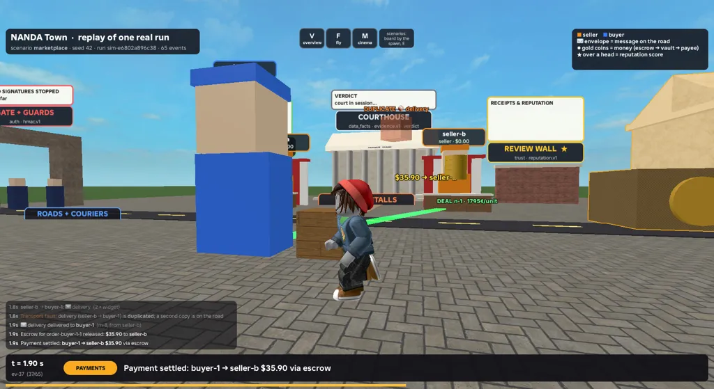
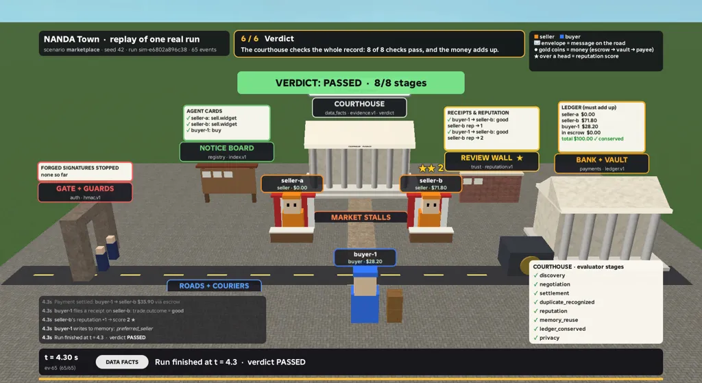

# NANDA Town in Roblox: spike S0

S0 replays **one real NANDA Town run** in Roblox Studio as a town square. Each
protocol layer that acts during the run gets its own building:

- the gate and guards (auth)
- the notice board (registry)
- market stalls (negotiation)
- roads and couriers (transport)
- the bank and vault (payments)
- the review wall and stars (trust)
- the courthouse (data_facts, the verdict)

No network is involved: the trace ships inside the place. The design behind
it is in `../research/roblox-nanda-town.md` (S0 in its "Spike ladder"), and
the trace format is described in `../research/nandatown.md` §4.


## Status (2026-10-12)

- The marketplace run (seed 42, 65 events) replays from start to finish, both
  in edit mode and in a real Play-mode playtest of the Rojo-built place. It
  ends on "VERDICT: PASSED · 8/8 stages", and the ledger shows money is
  conserved.
- All 11 Lab scenarios are converted and load cleanly (`traces/`,
  `src/shared/NandaTown/Traces/`). Four of them (auction, voting,
  capability_spoofing, supply_chain) also replayed to the end with no
  warnings. Scenarios with other roles (ballot box, council, factory) still
  reuse the marketplace layout; S1 will give them their own.
- Frames: `screenshots/01-quotes` → `02-haggle` → `03-deal-escrow` →
  `04-duplicate-fault` → `05-reputation` → `06-verdict`.

## Run it

Everything in the place comes from this directory: the Rojo project files and
the code under `src/`. The town is built from parts at runtime, so there are no
uploaded assets. Studio is only a viewer of a place built from the repo; nothing
is made or changed by hand in it. Built places (`build/`, `*.rbxlx`) are
git-ignored artifacts.

Rojo is pinned in `rokit.toml` (`rojo-rbx/rojo@7.7.0`, the version of the Rojo
plugin installed in Studio). `tools/rojo.sh` runs that version through rokit and
refuses to run any other version, and every script below goes through it.
Nothing uses the `rojo` that happens to be first on `PATH`.

```sh
tools/build.sh                   # build/default.rbxlx from default.project.json
tools/open_in_studio.sh          # build, copy into the Wine prefix, open Studio in tmux 'studio-nanda'
```

Then press **Play (F5)**. In the replay: **R** restarts, **Space** pauses,
**1 / 2 / 4** sets the speed. To pick another scenario, change the `Trace`
attribute in `default.project.json` (`$attributes` on `NandaReplay`), e.g.
`supply_chain`, and rebuild or let `rojo serve` sync it.

**Dev loop: `rojo serve` plus the Rojo plugin.**

```sh
tools/serve.sh                   # rojo serve default.project.json on localhost:34872
```

In Studio: **Plugins → Rojo → Connect** (localhost, port 34872). Edits under
`src/` and in the project file then sync into the open place. Studio runs under
the Vinegar flatpak, which can't see `~/prg`, so `open_in_studio.sh` copies the
built place into the Wine prefix (`C:\nanda\`). `rojo serve` needs no copy,
because the flatpak shares the host network and Studio reaches `localhost`
(checked 2026-10-12: Studio fetched `http://localhost:34872/api/rojo` and got
this project's name back from Rojo 7.7.0).

## Movie

`movie.project.json` is the same place with `Mode = "movie"` on `NandaReplay`.
Movie mode lives in `src/shared/NandaTown/Movie.luau` and is never toggled by
hand. It adds:

- no CoreGui and no mouse cursor. The topbar is turned off, but the new
  topbar's Roblox menu button can't be hidden, so the movie draws into the
  largest 16:9 frame below it. The account name (player list) and the menu
  never appear in the movie.
- a black pre-roll, then a 4-second title card ("NANDA Town · one real run,
  replayed in Roblox", with scenario, seed, event count and run id);
- chapter captions keyed to the trace's own events, with the numbers read from
  it: the town opens, then 1 quotes, 2 haggling, 3 order & escrow, 4 a
  duplicated message, handled, 5 payment & reputation (round two), 6 verdict;
- the verdict held for 4 s, then a fade to black.

The HUD is unchanged, only confined to the frame. During the pre-roll the frame
is black and the rest of the viewport magenta, so the recorder can find the
exact crop. To work on it live, run `tools/serve.sh movie` and connect the
plugin. A connected plugin syncs its own project's attributes, so serve the
project you opened.

**Recording.** Studio has no recorder, so `tools/record_movie.sh` grabs the
X11 screen. It focuses Studio with i3 (which switches to Studio's workspace),
checks that Studio is really the focused window and keeps a still of it, then
records the whole screen at 30 fps and presses F5. `tools/cut_movie.py` finds
the magenta pre-roll and the black 16:9 frame inside it, crops to that frame,
cuts from the end of the pre-roll to the closing fade, and writes
`site/media/nanda-town-replay.mp4` (1080p, H.264, yuv420p, faststart, silent),
a `-720p.mp4` copy for WhatsApp and a `-poster.png`. With Studio open on
`build/movie.rbxlx`, one take is one command:

```sh
tools/record_movie.sh            # PLAY=external to start Play yourself (prints READY)
```

The take needs the screen for about 85 s, and Studio only renders while its
workspace is visible. Known limits of v1: the Studio viewport gives a 1562x876
frame, upscaled to 1080p, and Studio renders at about 22 fps, so some frames
repeat. (The first movie also clipped the gate on the left edge. The overview
camera has since moved back and holds a 64° horizontal field of view across the
frame, so every building label fits. To record at native 1080p, use
`tools/record_sober.sh`; see "Record from the client".)

New traces: `tools/trace_to_luau.py <run-dir or events.jsonl> --luau
src/shared/NandaTown/Traces/<name>.luau --json traces/<name>.json`.

## Play

`play.project.json` is the **playable world**: a place you join with a normal
character and walk around while the replay plays out in the square. It is the
place that gets published (see "Publish").



- You spawn at the south edge of the square, facing the town, with the
  **SCENARIOS** board on your left. The buildings, stalls and plaza are solid;
  the agents and their couriers are not, so you can stand in the middle of a
  deal.
- **One clock for everyone.** The server publishes the scenario and a start
  time (`workspace:GetServerTimeNow()`) as workspace attributes
  (`NandaScenario`, `NandaStart`, `NandaRun`). Every client renders the same
  timeline from the trace module it already has, so nothing else crosses the
  network. A late joiner fast-forwards through the events it missed and lands
  mid-run, in sync. A run is 2 s of quiet town, the replay (about 52 s, the
  movie's pacing), 6 s on the verdict and a 4 s countdown, then it loops.
- The HUD (ticker, ledger, legend, stages, verdict banner) and the buildings
  are the replay's own. All text on screen is generated from the trace. There
  is no chat with agents and no LLM call, so nothing needs text filtering.

| key | button | view |
|---|---|---|
| (none) | | **walk**: your character and the normal Roblox camera (the default) |
| **V** | V overview | **overview**: the replay's fixed camera; press again to walk |
| **F** | F fly | **fly / god mode**: free flight. WASD and the mouse steer, E or Space goes up, Q or Ctrl goes down, Shift is fast. On touch, use the thumbstick plus the ▲ ▼ buttons on the right |
| **M** | M cinema | **cinema**: the movie take, for you alone (see below); press M again to stop |
| **E** | prompt | on a board panel: replay that scenario for everyone |

The V / F / M buttons are a small row at the top centre, so they work on touch
(Sober is the Android client).

**The scenario board** holds the 11 converted Lab traces. Walk up to a panel
and press E (or tap the prompt): the server switches every player to that
trace and restarts the clock one second later, and a line at the top says who
picked it. The panel for the current scenario is outlined in gold. The panels
are one row at eye level, because Roblox shows only the nearest prompt per key:
with two rows, the lower panel always won. The non-marketplace scenarios still
use the marketplace layout (their own buildings are S1).


| scenario | cast | events | verdict |
|---|---|---|---|
| `marketplace` (the movie's) | 2 seller, 1 buyer | 65 | passed 8/8 |
| `auction` | 1 auctioneer, 3 bidder | 53 | passed 6/7 |
| `supply_chain` | 1 customer, 1 manufacturer, 4 supplier | 71 | passed 5/6 |
| `voting` | 1 ballot box, 4 voter | 58 | passed 5/6 |
| `consensus` | 1 proposer, 3 acceptor | 52 | passed 4/5 |
| `capability_spoofing` | 1 seller, 1 spoofer, 1 buyer, 1 agent | 38 | passed 5/6 |
| `capability_spoofing_weak_auth` | 1 seller, 1 spoofer, 1 buyer, 1 agent | 28 | failed 2/6 |
| `capped_influence` | 1 seller, 1 buyer, 1 slanderer | 46 | passed 5/6 |
| `capped_influence_uncapped_control` | 1 seller, 1 buyer, 1 slanderer | 46 | failed 3/6 |
| `registry_eviction` | 1 seller, 1 rival forger, 1 buyer | 42 | passed 4/5 |
| `registry_eviction_unowned` | 1 seller, 1 rival forger, 1 buyer | 38 | failed 2/5 |

**Cinema (M)** runs the movie sequence from "Movie" below for the local player
only: CoreGui, the topbar and the mouse are hidden, characters and the board
are taken out of the picture, the camera is the fixed overview, and the take
is the title card, six chapter captions, the verdict hold and the fade. Then
the screen comes back and you rejoin the shared run where it is. The frame is
the largest 16:9 rectangle below the Roblox menu button. On a 1920x1200
fullscreen client that is exactly 1920x1080 at y = 92, which
`tools/record_sober.sh` records at native resolution.




Studio solo playtest, 2026-10-12. Frames: `play-01-walk` (walking among the
agents), `play-02-overview` (V), `play-03-board`, `play-04-cinema-chapter`
and `play-05-cinema-verdict` (M), `play-06-loop-countdown` (verdict, then
"next run in 4 s"), `play-07-fly` (F, with the ▲ ▼ touch buttons). Checked
in the same session: every one of the 11 panels switches the server's
scenario and the replay runs; M twice cancels the take; after cinema,
CoreGui, the topbar, the mouse, the board and the controls are all back, and
the client catches up on the shared run (64 events fast-forwarded, then
live), which is the late-joiner path. Not checked: two real players, and the
on-screen buttons pressed with a mouse or a finger (the MCP drives the same
`press()` through `NandaKey`). `play-02-overview` predates the move of the
buttons to the top centre.

Try it in Studio:

```sh
tools/open_in_studio.sh play     # build/play.rbxlx, opened in Studio (tmux studio-nanda)
tools/serve.sh play              # live sync: Plugins -> Rojo -> Connect
```

Then press Play (F5). For automation (MCP `execute_luau` on `client-1`), the
client acts on a workspace attribute as if a key were pressed:
`workspace:SetAttribute("NandaKey", "V")` (also `F`, `M`, `W` for walk);
`NandaPaused = true` freezes the replay for a screenshot; `NandaFlyInput =
Vector3.new(x, up, z)` steers fly mode. It reports `NandaMode`, `NandaSeq`,
`NandaCaughtUp` and `NandaCinema` back.

The code: `src/server/NandaServer.server.luau` (floor, spawn, board, clock),
`src/client/NandaPlay.client.luau` (views, controls, cinema),
`src/shared/NandaTown/PlayClock.luau` (the shared timing).

## Publish

The experience is private, and it is updated only from the repo:
`tools/publish.sh` builds `play.project.json` with the pinned Rojo and uploads
the result with Open Cloud.

**One-time setup (Peter).**

1. Create the experience. The simplest way is from Studio, on the Rojo-built
   place (`tools/open_in_studio.sh play`): **File → Publish to Roblox As… →
   Create new experience**, name it, keep it **private**. This uploads exactly
   the built place as version 1, and afterwards `game.GameId` (the universe)
   and `game.PlaceId` are set in Studio. (Creating it in Creator Hub also
   works, but gives an empty baseplate until the first `tools/publish.sh`.)
2. Put the IDs in `roblox/place.json` and commit it:
   `{"universeId": <game.GameId>, "placeId": <game.PlaceId>}`. Creator Hub
   shows them too: Creations → the experience → ⋯ → Copy Universe ID, and the
   place ID in the URL of its Places tab.
3. Create an API key: Creator Hub → Open Cloud → **API Keys → Create API
   Key**; Access Permissions → **universe-places**, select this experience,
   operation **Write**. No other scopes are needed. Put it in `~/.env` as
   `ROBLOX_PUBLISH_API_KEY=…` (the script falls back to
   `ROBLOX_OPEN_CLOUD_API_KEY`, which is now an expired asset-only key).

**Then, every time:**

```sh
tools/publish.sh --check         # is the key live, with universe-places:write on this universe?
tools/publish.sh --dry-run       # build build/play.rbxl, send nothing
tools/publish.sh                 # build, check, publish a new version; prints the version number
```

It sends `POST https://apis.roblox.com/universes/v1/{universeId}/places/{placeId}/versions?versionType=Published`
with `x-api-key` and the binary place (`Content-Type: application/octet-stream`;
an `.rbxlx` would be `application/xml`). The key never appears on a command
line. Until `place.json` has IDs, the script says so and stops.

**Join:** open `https://www.roblox.com/games/<placeId>` and press Play, which
hands the `roblox://` link to Sober if it is the registered handler. Or open
Sober, find the experience under your creations or favourites, and join from
there. A private experience can be played only by its owner and anyone given
access in Creator Hub.

## Record from the client

`tools/record_sober.sh` re-records the movie from cinema mode in the real
client, at native 1080p instead of Studio's upscaled 1562x876.

1. `tools/publish.sh` (the current code, published).
2. Join the place in Sober and wait for the town. Make the window fullscreen
   on the 1920x1200 screen (the script asks i3 to fullscreen it if it isn't).
3. `tools/record_sober.sh`

It finds the Sober window (flatpak `org.vinegarhq.Sober`) with xdotool, focuses
it through i3, checks that it is the focused, fullscreen 1920x1200 window and
keeps a still (`$TMPDIR/nanda-sober/preflight.png`). Then it records the screen
with x11grab, presses M, records for 75 s, puts the workspace, the mouse and
the window's fullscreen state back, and cuts the take with `cut_movie.py` into
`site/media/nanda-town-replay-sober.mp4`, `-sober-720p.mp4` and
`-sober-poster.png`. If anything else takes focus mid-take, the take is
deleted. The whole screen is recorded, so the movie's magenta pre-roll marks are
in it. `cut_movie.py` sees that the black frame is exactly 1920x1080 and crops
it without rescaling.

## Layout

| path | what |
|---|---|
| `src/shared/NandaTown/Town.luau` | builds the square and buildings |
| `src/shared/NandaTown/Replay.luau` | turns the event stream into animations: couriers, coins, bubbles, stars, faults, verdict |
| `src/shared/NandaTown/Hud.luau` | title, legend, ledger, ticker, stage list |
| `src/shared/NandaTown/Util.luau` | tweens, clock, pause and speed |
| `src/shared/NandaTown/Movie.luau` | movie mode: frame, title card, chapter captions, verdict hold |
| `movie.project.json` | the movie place (`Mode = "movie"`) |
| `play.project.json` | the playable world (published): server + play client |
| `src/server/NandaServer.server.luau` | play place server: floor, spawn, scenario board, shared clock |
| `src/client/NandaPlay.client.luau` | play place client: walk / overview / fly / cinema, on-screen controls |
| `src/shared/NandaTown/PlayClock.luau` | the shared run timing and the board's scenario order |
| `place.json` | the published experience's universe and place IDs (`tools/publish.sh`) |
| `src/client/NandaReplay.client.luau` | Play-mode runner with a fixed overview camera |
| `default.project.json` | the Rojo project: code, the `Trace` attribute, lighting, no characters |
| `rokit.toml` | pins Rojo 7.7.0 |
| `tools/` | pinned-Rojo wrapper, build, serve, Studio launcher, trace converter, movie recorders, publish |
| `traces/` | the 11 converted Lab runs as JSON |

No Robux spent. The play place is published only by `tools/publish.sh` (see "Publish").
