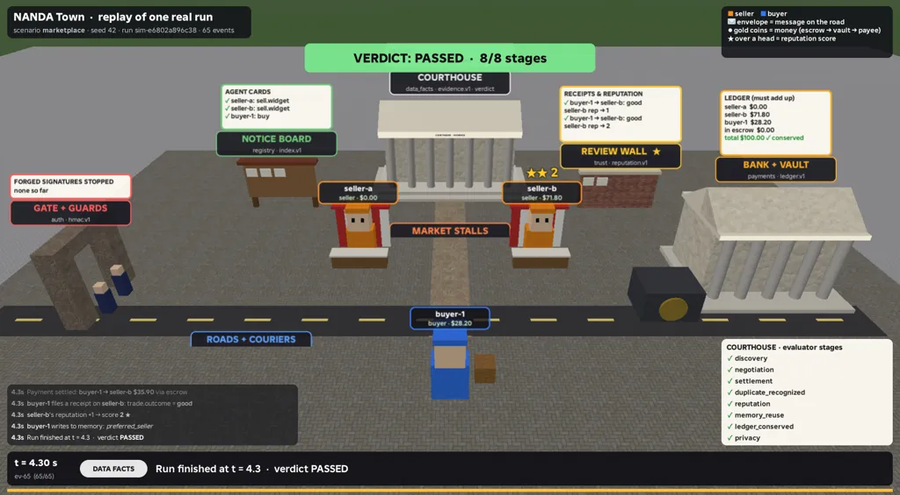
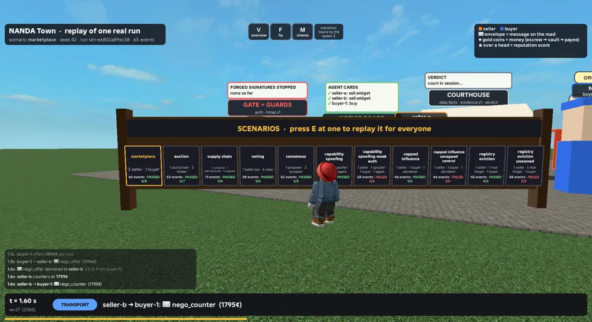
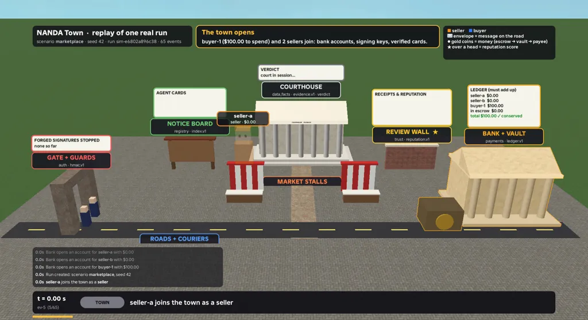

# NANDA Town in Roblox

The place replays **one real NANDA Town run** as a town square. Each
protocol layer that acts during the run gets its own building:

- the gate and guards (auth)
- the notice board (registry)
- market stalls (negotiation)
- roads and couriers (transport)
- the bank and vault (payments)
- the review wall and stars (trust)
- the courthouse (data_facts, the verdict)

No network is involved: the trace ships inside the place. The trace format is
described in [`../docs/trace-format.md`](../docs/trace-format.md).



## Status (2026-10-12)

- The marketplace run (seed 42, 65 events) replays from start to finish, both
  in edit mode and in a real Play-mode playtest of the Rojo-built place. It
  ends on "VERDICT: PASSED · 8/8 stages", and the ledger shows money is
  conserved.
- All 11 Lab scenarios are converted and load cleanly (`traces/`,
  `src/shared/NandaTown/Traces/`). Four of them (auction, voting,
  capability_spoofing, supply_chain) also replayed to the end with no
  warnings. Scenarios with other roles (ballot box, council, factory) still
  reuse the marketplace layout; S1 will give them their own.
- Frames: `screenshots/01-quotes` → `02-haggle` → `03-deal-escrow` →
  `04-duplicate-fault` → `05-reputation` → `06-verdict`.

## Run it

Everything in the place comes from this directory: the Rojo project files and
the code under `src/`. The town is built from parts at runtime, so there are no
uploaded assets. Studio is only a viewer of a place built from the repo; nothing
is made or changed by hand in it. Built places (`build/`, `*.rbxlx`) are
git-ignored artifacts.

Rojo is pinned in `rokit.toml` (`rojo-rbx/rojo@7.7.0`, the version of the Rojo
plugin installed in Studio). `tools/rojo.sh` runs that version through rokit and
refuses to run any other version, and every script below goes through it.
Nothing uses the `rojo` that happens to be first on `PATH`.

```sh
tools/build.sh                   # build/default.rbxlx from default.project.json
tools/open_in_studio.sh          # build, copy into the Wine prefix, open Studio in tmux 'studio-nanda'
```

Then press **Play (F5)**. In the replay: **R** restarts, **Space** pauses,
**1 / 2 / 4** sets the speed. To pick another scenario, change the `Trace`
attribute in `default.project.json` (`$attributes` on `NandaReplay`), e.g.
`supply_chain`, and rebuild or let `rojo serve` sync it.

**Dev loop: `rojo serve` plus the Rojo plugin.**

```sh
tools/serve.sh                   # rojo serve default.project.json on localhost:34872
```

In Studio: **Plugins → Rojo → Connect** (localhost, port 34872). Edits under
`src/` and in the project file then sync into the open place. Studio runs under
the Vinegar flatpak, which can't see `~/prg`, so `open_in_studio.sh` copies the
built place into the Wine prefix (`C:\nanda\`). `rojo serve` needs no copy,
because the flatpak shares the host network and Studio reaches `localhost`
(checked 2026-10-12: Studio fetched `http://localhost:34872/api/rojo` and got
this project's name back from Rojo 7.7.0).

## Movie

`movie.project.json` is the same place with `Mode = "movie"` on `NandaReplay`.
Movie mode lives in `src/shared/NandaTown/Movie.luau` and is never toggled by
hand. It adds:

- no CoreGui and no mouse cursor. The topbar is turned off, but the new
  topbar's Roblox menu button can't be hidden, so the movie draws into the
  largest 16:9 frame below it. The account name (player list) and the menu
  never appear in the movie.
- a black pre-roll, then a 4-second title card ("NANDA Town · one real run,
  replayed in Roblox", with scenario, seed, event count and run id);
- chapter captions keyed to the trace's own events, with the numbers read from
  it: the town opens, then 1 quotes, 2 haggling, 3 order & escrow, 4 a
  duplicated message, handled, 5 payment & reputation (round two), 6 verdict;
- the verdict held for 4 s, then a fade to black.

The HUD is unchanged, only confined to the frame. During the pre-roll the frame
is black and the rest of the viewport magenta, so the recorder can find the
exact crop. To work on it live, run `tools/serve.sh movie` and connect the
plugin. A connected plugin syncs its own project's attributes, so serve the
project you opened.

**Recording.** Studio has no recorder, so `tools/record_movie.sh` grabs the
X11 screen. It focuses Studio with i3 (which switches to Studio's workspace),
checks that Studio is really the focused window and keeps a still of it, then
records the whole screen at 30 fps and presses F5. `tools/cut_movie.py` finds
the magenta pre-roll and the black 16:9 frame inside it, crops to that frame,
cuts from the end of the pre-roll to the closing fade, and writes
`site/media/nanda-town-replay.mp4` (1080p, H.264, yuv420p, faststart, silent),
a `-720p.mp4` copy for WhatsApp and a `-poster.png`. With Studio open on
`build/movie.rbxlx`, one take is one command:

```sh
tools/record_movie.sh            # PLAY=external to start Play yourself (prints READY)
```

The take needs the screen for about 85 s, and Studio only renders while its
workspace is visible. Known limits of v1: the Studio viewport gives a 1562x876
frame, upscaled to 1080p, and Studio renders at about 22 fps, so some frames
repeat. (The first movie also clipped the gate on the left edge. The overview
camera has since moved back and holds a 64° horizontal field of view across the
frame, so every building label fits. To record at native 1080p, use
`tools/record_sober.sh`; see "Record from the client".)

New traces: `tools/trace_to_luau.py <run-dir or events.jsonl> --luau
src/shared/NandaTown/Traces/<name>.luau --json traces/<name>.json`.

## Play

`play.project.json` is the **playable world**: a place you join with a normal
character and walk around while the replay plays out in the square. It is the
place that gets published (see "Publish").


- You spawn at the south edge of the square, facing the town, with the
  **SCENARIOS** board on your left. The buildings, stalls and plaza are solid;
  the agents and their couriers are not, so you can stand in the middle of a
  deal.
- **One clock for everyone.** The server publishes the scenario and a start
  time (`workspace:GetServerTimeNow()`) as workspace attributes
  (`NandaScenario`, `NandaStart`, `NandaRun`). Every client renders the same
  timeline from the trace module it already has, so nothing else crosses the
  network. A late joiner fast-forwards through the events it missed and lands
  mid-run, in sync. A run is 2 s of quiet town, the replay (about 52 s, the
  movie's pacing), 6 s on the verdict and a 4 s countdown, then it loops.
- The HUD (ticker, ledger, legend, stages, verdict banner) and the buildings
  are the replay's own. All text on screen is generated from the trace. There
  is no chat with agents and no LLM call, so nothing needs text filtering.

| key | button | view |
|---|---|---|
| (none) | | **walk**: your character and the normal Roblox camera (the default) |
| **V** | V overview | **overview**: the replay's fixed camera; press again to walk |
| **F** | F fly | **fly / god mode**: free flight. WASD and the mouse steer, E or Space goes up, Q or Ctrl goes down, Shift is fast. On touch, use the thumbstick plus the ▲ ▼ buttons on the right |
| **M** | M cinema | **cinema**: the movie take, for you alone (see below); press M again to stop |
| **E** | prompt | on a board panel: replay that scenario for everyone |

The V / F / M buttons are a small row at the top centre, so they work on touch
(Sober is the Android client).

**The scenario board** holds the 11 converted Lab traces. Walk up to a panel
and press E (or tap the prompt): the server switches every player to that
trace and restarts the clock one second later, and a line at the top says who
picked it. The panel for the current scenario is outlined in gold. The panels
are one row at eye level, because Roblox shows only the nearest prompt per key:
with two rows, the lower panel always won. The non-marketplace scenarios still
use the marketplace layout (their own buildings are S1).



| scenario | cast | events | verdict |
|---|---|---|---|
| `marketplace` (the movie's) | 2 seller, 1 buyer | 65 | passed 8/8 |
| `auction` | 1 auctioneer, 3 bidder | 53 | passed 6/7 |
| `supply_chain` | 1 customer, 1 manufacturer, 4 supplier | 71 | passed 5/6 |
| `voting` | 1 ballot box, 4 voter | 58 | passed 5/6 |
| `consensus` | 1 proposer, 3 acceptor | 52 | passed 4/5 |
| `capability_spoofing` | 1 seller, 1 spoofer, 1 buyer, 1 agent | 38 | passed 5/6 |
| `capability_spoofing_weak_auth` | 1 seller, 1 spoofer, 1 buyer, 1 agent | 28 | failed 2/6 |
| `capped_influence` | 1 seller, 1 buyer, 1 slanderer | 46 | passed 5/6 |
| `capped_influence_uncapped_control` | 1 seller, 1 buyer, 1 slanderer | 46 | failed 3/6 |
| `registry_eviction` | 1 seller, 1 rival forger, 1 buyer | 42 | passed 4/5 |
| `registry_eviction_unowned` | 1 seller, 1 rival forger, 1 buyer | 38 | failed 2/5 |

**Cinema (M)** runs the movie sequence from "Movie" below for the local player
only: CoreGui, the topbar and the mouse are hidden, characters and the board
are taken out of the picture, the camera is the fixed overview, and the take
is the title card, six chapter captions, the verdict hold and the fade. Then
the screen comes back and you rejoin the shared run where it is. The frame is
the largest 16:9 rectangle below the Roblox menu button. On a 1920x1200
fullscreen client that is exactly 1920x1080 at y = 92, which
`tools/record_sober.sh` records at native resolution.




Studio solo playtest, 2026-10-12. Frames: `play-01-walk` (walking among the
agents), `play-02-overview` (V), `play-03-board`, `play-04-cinema-chapter`
and `play-05-cinema-verdict` (M), `play-06-loop-countdown` (verdict, then
"next run in 4 s"), `play-07-fly` (F, with the ▲ ▼ touch buttons). Checked
in the same session: every one of the 11 panels switches the server's
scenario and the replay runs; M twice cancels the take; after cinema,
CoreGui, the topbar, the mouse, the board and the controls are all back, and
the client catches up on the shared run (64 events fast-forwarded, then
live), which is the late-joiner path. Not checked: two real players, and the
on-screen buttons pressed with a mouse or a finger (the MCP drives the same
`press()` through `NandaKey`). `play-02-overview` predates the move of the
buttons to the top centre.

Try it in Studio:

```sh
tools/open_in_studio.sh play     # build/play.rbxlx, opened in Studio (tmux studio-nanda)
tools/serve.sh play              # live sync: Plugins -> Rojo -> Connect
```

Then press Play (F5). For automation (MCP `execute_luau` on `client-1`), the
client acts on a workspace attribute as if a key were pressed:
`workspace:SetAttribute("NandaKey", "V")` (also `F`, `M`, `W` for walk);
`NandaPaused = true` freezes the replay for a screenshot; `NandaFlyInput =
Vector3.new(x, up, z)` steers fly mode. It reports `NandaMode`, `NandaSeq`,
`NandaCaughtUp` and `NandaCinema` back.

The code: `src/server/NandaServer.server.luau` (floor, spawn, board, clock),
`src/client/NandaPlay.client.luau` (views, controls, cinema),
`src/shared/NandaTown/PlayClock.luau` (the shared timing).

## Red vs. Blue (live)

A spike (branch `redblue`, 2026-10-21) of a game mode for the play place:
**two human teams play at the seams that NANDA Town's layers already
define.** The layers are the town's automatic defences, and a council of
the players present decides which ones run.

**Reached from** the arch on the right of the spawn ("RED vs. BLUE · LIVE ·
E"). It switches everyone; the same arch, or any panel on the scenario
board, goes back to the replay. Until someone walks through it the place is
exactly the replay described above.

**Not NANDA Town's code.** The live town is `TownSim`, a small Luau
re-implementation of NANDA Town's marketplace written for this spike. It
speaks NANDA Town's event envelope and event kinds
([`../docs/trace-format.md`](../docs/trace-format.md)) and models three
layers in a simplified way. It does not run NANDA Town and is not evaluated by
it. The way to put the real NANDA Town behind it is described under "Next step".

### How a round plays

A round is 3 minutes of a running market (2 sellers, 3 buyers, a deal every
~10–20 s), then 12 s of results. Step on the **red** or **blue** pad by the
spawn to pick a side; a bot plays any side without a human.

- **Red** has 4 attacks per round, made at a building with a prompt (E):
  - **Forge an invoice at the Gate:** an invoice signed as a real seller,
    asking a buyer to pay $30 to a payee alias. Under `auth hmac.v1` the guards
    stop it at once (`signature_invalid`). Under `plain.v1` the guards are
    gone: the courier crosses the road, the invoice sits on the buyer's desk,
    and 12 s after it set off the buyer pays red.
  - **Spoof a card at the Notice Board:** a card claiming a real seller's
    name, 20% cheaper. Under `registry index.owned.v1` the board refuses it
    (`card_publish_refused`). Under `index.v1` it is pinned (UNVERIFIED with
    `hmac.v1`, verified-looking with `plain.v1`); the next bargain hunter, and
    the claimed seller's loyal buyer, deal with red's stall instead, and the
    escrow is paid to red.
  - An attack that pays out is an **escape: +10 red**.
- **Blue** holds the **watchtower** (east of the spawn; the prompt at its foot
  lifts you up) and has the V overview and F fly views. Click near a courier
  or a card to **flag** it (the nearest one within 44 px of the click; mouse
  hover outlines it). A live threat flagged before it pays out is a
  **catch: +1**; anything honest is a **false alarm: −1**, and the honest
  courier is held 4 s (an honest card is skipped by buyers for 4 s).
- **Every attack has a fair, visible tell:**

| attack | tells anyone can see |
|---|---|
| forged invoice | its courier sets off from the **gate**, not the seller's stall; the payee (`seller-a.billing`, `se11er-b`, …) is not on the notice board; it lingers on the buyer's desk (an honest invoice is paid at once) |
| spoofed card | **two cards with one name** on the board (and in its list); under `hmac.v1` the guards flag the signature and the card is stamped UNVERIFIED; the deal's couriers go to and come from the **red-team stall**, not the seller's |
| either | the ticker prints what the town recorded, e.g. `seller-a → buyer-2: invoice (3000¢ → pay sellr-b)` |

- **The council** (panel on the right, usable from anywhere; the chamber west
  of the spawn shows the laws) votes on two swaps, `auth hmac.v1 ↔ plain.v1`
  and `registry index.v1 ↔ index.owned.v1`. A strict majority of the players
  present carries a swap at once, in the middle of a round: the guards walk
  off or back, the board gets or loses a padlock (and adopting
  `index.owned.v1` takes impostor cards down). Laws persist across rounds. It
  starts at NANDA Town's defaults, `hmac.v1` and `index.v1`: forging is
  blocked, card spoofing works, so the obvious first vote is
  `index.owned.v1`.
- **The trade-off.** Stronger layers cost throughput: a signature check adds
  1.1 s per courier hop and an ownership check 4 s per registry lookup. Deals
  settled per 3-minute round (mean of 5 seeds, `tools/test.sh`):
  `plain.v1 + index.v1` 18.2, `hmac.v1 + index.v1` (default) 15.0,
  `hmac.v1 + index.owned.v1` 12.8. The **town economy** (deals settled) is a
  shared number on the scoreboard.
- **Who wins.** Red takes a round only by getting something through *and*
  outscoring blue; a round where nothing escaped is blue's ("the town held"),
  even if blue's false alarms left it below zero.

All numbers are constants in `src/shared/NandaTown/RedBlue/Config.luau`. The
bots: `RED_BOT` / `BLUE_BOT` = `"auto"` (on whenever that team has no
humans), `"on"` or `"off"`. RedBot attacks every 28–40 s from 14 s in,
preferring an attack the current layers let through; its attacks never spend
a human's tokens (the first human on red gets the unspent ones). BlueBot
notices a live threat after 3.5 s with probability 0.06 per second and
false-alarms 0.006 per second. Over 10 seeded solo rounds (both bots) red wins
6/10 at the defaults, 9/10 with both layers weak, 0/10 with both strong.

All player-visible text is generated by the game: no typed text, no LLM call.

### What it looks like (Studio solo playtest, 2026-10-21)

| frame | what |
|---|---|
| `screenshots/redblue-01-forge-blocked-by-guards.png` | red forges under `hmac.v1`: the invoice falls at the gate, "1 forged signature stopped", `signature_invalid` on the ticker |
| `redblue-02-council-swap-guards-leave.png`, `-03-plain-no-guards.png` | one vote carries `auth → plain.v1`: the COUNCIL banner, "guards leave the gate", the guards walk off onto the plaza, the gate reads "NO GUARDS" |
| `redblue-04-forge-live-from-gate.png` | a forged invoice on the road under `plain.v1`, the alias payee in the ticker |
| `redblue-05-forge-caught-by-bluebot.png` | BlueBot flags it on buyer-2's desk after 8.3 s: CAUGHT +1 |
| `redblue-06-forge-invoice-on-buyers-desk.png`, `-07-forge-escapes.png`, `-10-forge-escapes-red-plus-10.png` | an unflagged forgery pays red $30 after 12 s: coins to the red-team stall, ESCAPED +10 |
| `redblue-08-spoof-refused-owned-registry.png` | after a vote for `index.owned.v1`: the padlock on the board, the spoofed card refused |
| `redblue-09-blue-catches-forge-by-click.png` | playing blue against RedBot: a click on the forged invoice (the real click path, `RBClickAt`) catches it |
| `redblue-12-results-scoreboard.png` | results between rounds: winner, scores, escapes / catches / blocked / false alarms, deals settled under which laws |
| `redblue-13-watchtower-view.png` | blue on the watchtower deck (the tower's sign has since moved out of this sightline) |
| `redblue-14-spoof-deal-routed-to-red-stall.png` | defaults (`hmac.v1`, `index.v1`): two seller-a cards, one UNVERIFIED; the impostor answers "1596¢ each" from the red-team stall and its couriers come from there |
| `redblue-15-back-to-the-replay.png` | the arch takes everyone back: the marketplace replay, unchanged |

Frames 02, 03, 14 and 15 are from the final build (`878ccbb`); 01 and 04–13
from the build before it, where the portal still stood in the overview's
bottom-right corner and the council banner hid under the scoreboard. The
red-team stall has moved once more since (to the left of buyer-1, checked
in Studio but not re-shot).

### FlowBench telemetry

Watcher behaviour is logged on the server as structured records, kept in
memory (`Telemetry.luau`, last 5,000) and printed one JSON object per line
with the prefix `FLOWBENCH `: `round_started`, `threat_appeared` (attack, by,
layers, outcome if a layer stopped it), `threat_resolved` (outcome, seconds
alive, each blue watcher's camera mode), `flag` (player, team, target,
result, **latency** from the threat appearing, camera mode), `click`,
`camera` (walk / overview / fly / tower), `vote`, `layer_swapped`,
`round_summary`. For example:

```
FLOWBENCH {"kind":"flag","player":"BlueBot","target":"card-3","result":"catch","latency":37.9,"camera":"bot","team":"blue","threat":"threat-1","attack":"spoof","t":51.98,"n":6}
```

No DataStore yet: collect them from the server log.

### Code and tests

| path | what |
|---|---|
| `src/shared/NandaTown/RedBlue/TownSim.luau` | the live marketplace: deal cycle, auth / registry / transport, attacks, catches, holds, snapshots for late joiners |
| `src/shared/NandaTown/RedBlue/Policy.luau` | agent decisions behind a 6-function interface (`chooseCard`, `offer`, `accept`, `payInvoice`, `quote`, `counter`); scripted only |
| `src/shared/NandaTown/RedBlue/Game.luau` | rounds, teams, tokens, flags, scoring, council, bots, telemetry; the only thing the server talks to |
| `src/shared/NandaTown/RedBlue/{Council,Bots,Telemetry,Config,Rng}.luau` | majority voting; RedBot / BlueBot; FlowBench records; every constant; a seeded RNG |
| `src/server/RedBlueServer.luau` | Teams, pads, watchtower, chamber, attack prompts, RemoteEvents (`NandaRedBlue.Events/Hello/Flag/Vote/Camera/Notice`), `RB_*` attributes, telemetry lines |
| `src/shared/NandaTown/RedBlueView.luau` | the client: the live town via `Replay.stage`, cards, guards, padlock, flagging, the game HUD |
| `src/shared/NandaTown/Replay.luau` | `Replay.stage(trace, opts)` builds the town and handlers; `Replay.run` plays a trace through it, `RedBlueView` a live stream (`opts.live`, with the events' `travel` / `origin` / `dest` / `copy` hints) |

The core (`RedBlue/*`) uses no Roblox services, so it runs headless under
[Lune](https://lune-org.github.io/docs), pinned in `rokit.toml`:

```sh
tools/test.sh            # every tests/test_*.luau: TownSim, attacks x layers, scoring, council, rounds, bots, syntax of all src/
tools/test.sh council    # one file
```

Events carry the private threat id as `_threat` on the server only;
`Game.public` strips every `_` key before anything is sent to a client (a
test checks it).

Automation (MCP `execute_luau`): on the server, `NandaServerCmd = "live"` /
`"replay"`; on the client, `RBClickAt = Vector2(x, y)` (a click at that
viewport point), `RBVote = "auth" | "registry"`, and red's prompts fire with
`prompt:InputHoldBegin()`. The client reports `RBTeam`, `RBHover`,
`RBLastNotice`, `RBFlaggables`. Note that a ProximityPrompt only shows (and
so only triggers) while it is on screen: from the V overview, the
watchtower's prompt is off-frame, so press W first.

### Next step: a real NANDA Town behind it (designed, not built)

1. **Event source.** Replace `TownSim` with a NANDA Town server in Track mode
   (its coordinator is plain HTTP: runs, participants, messages, inboxes and
   an event log). `RedBlueServer` polls the event log every second with
   `HttpService` (60 requests/min of the 500/min a Roblox game server may
   make), maps Track's event kinds onto the replay's vocabulary in a small
   adapter (the same role `travel` / `origin` / `dest` play now), and
   forwards them to clients exactly as today. A tunnel or a hosted
   coordinator is needed: a live Roblox server cannot reach `localhost`.
2. **Human actions back.** Red's attacks become messages POSTed by an
   attacker participant (forge = a message claiming another sender; spoof = a
   card publish), blue's flags a POST that the town records, council swaps a
   change of layer plugin. Two gaps to close upstream: Track does not run
   the Lab's layer plugins today, so either layers come to Track or each
   round is a short Lab run (`--layer auth=plain.v1`) streamed at game pace;
   and the attack/flag endpoints do not exist yet.
3. **LLM-driven agents.** Two ways, both fit the budget. (a) Keep the town in
   Roblox and make a `Policy` remote: each decision is one HTTPS call to a
   harness endpoint with the `view` as JSON; about six decisions per deal and
   ~15 deals a round is ~30 calls/min, well inside 500/min. Decisions must
   become asynchronous (an LLM takes seconds), with the scripted policy as
   the timeout fallback. (b) Better: let the harness drive the agents
   directly against the NANDA Town server (Track already lets an agent join
   from outside over HTTP), so LLM traffic never touches Roblox, and Roblox
   stays a viewer plus a human-action injector at ~1 request/s.

### Known gaps

- `TownSim` is a sketch of the marketplace, not NANDA Town: no evaluator, no
  memory or privacy layers, no Track semantics (leases, acks, crashes).
- The **Duplicate at the Roads** attack is not built; honest duplicate and
  drop faults are, as noise blue must not flag.
- Flags are client-picked ids sent to the server; the server validates them
  against live state but does not check line of sight from the tower.
- The council has no proposal step or quorum timer; a solo player carries
  every vote alone. Votes are buttons, not a chamber ritual.
- Economy is shown but not scored for either team.
- Tested in a Studio solo playtest only, not with two real players; touch
  input (tap to flag) is wired but untested.

## Publish

The experience is public since 2026-10-13: <https://www.roblox.com/games/74139499982225>. It is updated only from the repo:
`tools/publish.sh` builds `play.project.json` with the pinned Rojo and uploads
the result with Open Cloud.

**One-time setup (Peter).**

1. Create the experience. The simplest way is from Studio, on the Rojo-built
   place (`tools/open_in_studio.sh play`): **File → Publish to Roblox As… →
   Create new experience**, name it, keep it **private**. This uploads exactly
   the built place as version 1, and afterwards `game.GameId` (the universe)
   and `game.PlaceId` are set in Studio. (Creating it in Creator Hub also
   works, but gives an empty baseplate until the first `tools/publish.sh`.)
2. Put the IDs in `roblox/place.json` and commit it:
   `{"universeId": <game.GameId>, "placeId": <game.PlaceId>}`. Creator Hub
   shows them too: Creations → the experience → ⋯ → Copy Universe ID, and the
   place ID in the URL of its Places tab.
3. Create an API key: Creator Hub → Open Cloud → **API Keys → Create API
   Key**; Access Permissions → **universe-places**, select this experience,
   operation **Write**. No other scopes are needed. Put it in `~/.env` as
   `ROBLOX_PUBLISH_API_KEY=…` (the script falls back to
   `ROBLOX_OPEN_CLOUD_API_KEY`, which is now an expired asset-only key).

**Then, every time:**

```sh
tools/publish.sh --check         # is the key live, with universe-places:write on this universe?
tools/publish.sh --dry-run       # build build/play.rbxl, send nothing
tools/publish.sh                 # build, check, publish a new version; prints the version number
```

It sends `POST https://apis.roblox.com/universes/v1/{universeId}/places/{placeId}/versions?versionType=Published`
with `x-api-key` and the binary place (`Content-Type: application/octet-stream`;
an `.rbxlx` would be `application/xml`). The key never appears on a command
line. Until `place.json` has IDs, the script says so and stops.

**Team Create blocks it.** While Studio has the place open in a Team Create
(live editing) session, the endpoint answers `409 Conflict: Server is busy`.
That is the state Studio was left in after "Publish to Roblox As…", and two
attempts 90 s apart both got it on 2026-10-12. Close the place in Studio (or
turn Team Create off: click the collaborator icon at Studio's top right to open Live Collaborators, then ⋯ → Disable Team Create, and confirm the reload) before
`tools/publish.sh`. Otherwise, with the Rojo plugin connected (so the
DataModel is the repo), File → Publish to Roblox in Studio does the same job.

**Join:** open `https://www.roblox.com/games/<placeId>` and press Play, which
hands the `roblox://` link to Sober if it is the registered handler. Or open
Sober, find the experience under your creations or favourites, and join from
there.

**Who can play.** Released publicly on 2026-10-13 from Creator Hub (Manage audience → Release publicly; the age-restricted-content question answered No: no social hangout, user creation, violence, romance, alcohol, language or AI interaction). That gives the label *Content May Vary*, so it plays for **age-checked users 16+** (facial age estimation or ID on their Roblox account). It is excluded from the Recommended For You feed (Advanced settings), so it is found by link, by name search, or on the owner's profile. Under-16 reach would need the full questionnaire and 250 highly engaged players. Roblox has no unlisted mode; the alternatives are Playtest access for named users, or up to 10 friends as early testers.

## Record from the client

`tools/record_sober.sh` re-records the movie from cinema mode in the real
client, at native 1080p instead of Studio's upscaled 1562x876.

1. `tools/publish.sh` (the current code, published).
2. Join the place in Sober and wait for the town. Make the window fullscreen
   on the 1920x1200 screen (the script asks i3 to fullscreen it if it isn't).
3. `tools/record_sober.sh`

It finds the Sober window (flatpak `org.vinegarhq.Sober`) with xdotool, focuses
it through i3, checks that it is the focused, fullscreen 1920x1200 window and
keeps a still (`$TMPDIR/nanda-sober/preflight.png`). Then it records the screen
with x11grab, presses M, records for 75 s, puts the workspace, the mouse and
the window's fullscreen state back, and cuts the take with `cut_movie.py` into
`site/media/nanda-town-replay-sober.mp4`, `-sober-720p.mp4` and
`-sober-poster.png`. If anything else takes focus mid-take, the take is
deleted. The whole screen is recorded, so the movie's magenta pre-roll marks are
in it. `cut_movie.py` sees that the black frame is exactly 1920x1080 and crops
it without rescaling.

## Layout

| path | what |
|---|---|
| `src/shared/NandaTown/Town.luau` | builds the square and buildings |
| `src/shared/NandaTown/Replay.luau` | turns the event stream into animations: couriers, coins, bubbles, stars, faults, verdict |
| `src/shared/NandaTown/Hud.luau` | title, legend, ledger, ticker, stage list |
| `src/shared/NandaTown/Util.luau` | tweens, clock, pause and speed |
| `src/shared/NandaTown/Movie.luau` | movie mode: frame, title card, chapter captions, verdict hold |
| `movie.project.json` | the movie place (`Mode = "movie"`) |
| `play.project.json` | the playable world (published): server + play client |
| `src/server/NandaServer.server.luau` | play place server: floor, spawn, scenario board, shared clock |
| `src/client/NandaPlay.client.luau` | play place client: walk / overview / fly / cinema, on-screen controls |
| `src/shared/NandaTown/PlayClock.luau` | the shared run timing and the board's scenario order |
| `place.json` | the published experience's universe and place IDs (`tools/publish.sh`) |
| `src/client/NandaReplay.client.luau` | Play-mode runner with a fixed overview camera |
| `default.project.json` | the Rojo project: code, the `Trace` attribute, lighting, no characters |
| `rokit.toml` | pins Rojo 7.7.0 and Lune 0.11.0 (the headless tests) |
| `tools/` | pinned-Rojo wrapper, build, serve, Studio launcher, trace converter, movie recorders, publish, `test.sh` |
| `tests/` | Lune tests of the Red vs. Blue core (see "Red vs. Blue (live)") |
| `src/shared/NandaTown/RedBlue/`, `RedBlueView.luau`, `src/server/RedBlueServer.luau` | Red vs. Blue (live) |
| `traces/` | the 11 converted Lab runs as JSON |

No Robux spent. The play place is published only by `tools/publish.sh` (see "Publish").
